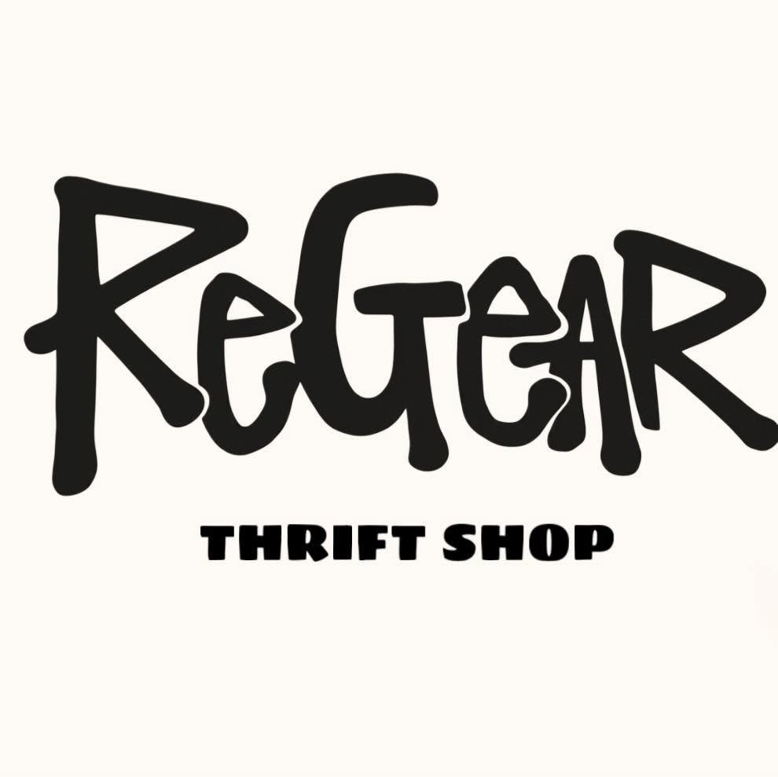

# ReGear Thrift Shop — 1-of-1 Streetwear & Vintage Archive

<p align="center">
  
</p>

**ReGear Thrift Shop** is a mobile-first, 1-of-1 streetwear and vintage apparel e-commerce web application built with **Next.js (App Router)**, **React**, **TypeScript**, **Tailwind CSS**, and **Supabase**.

Inspired by the editorial underground aesthetic of [Nightkidz](https://www.nightkidz.shop/us) and structured around the visual and conversion guardrails of [`elayadesign/ai-design-skills`](https://github.com/elayadesign/ai-design-skills).

---

## ✨ Key Features

- **Corrugated Roll-Up Garage Door Loader:** Opens with an interactive thrift-garage steel shutter animation before revealing the storefront rack.
- **Strictly 1-of-1 Inventory Model:** Every garment is a single-quantity vintage or streetwear piece (`Available`, `Reserved`, or `Sold Out`) priced in **Philippine Peso (`₱`)**.
- **Mobile-First 2-Column Streetwear Grid:**
  - Secondary angle photo swap on hover/tap.
  - Filter by category (`All`, `Tees`, `Hoodies & Sweats`, `Jackets & Outerwear`, `Bottoms & Cargo`, `Caps & Accessories`), shirt/apparel size (`S`, `M`, `L`, `XL`, `XXL`, `OS`), keyword/SKU search, or `Available Only`.
  - Tap-to-inspect multi-photo gallery modal with shirt size, fit measurements, condition rating (`10/10 Deadstock`, `9/10 Mint Vintage`, etc.), and honest flaw disclosures.
- **1-of-1 Bag & Direct Facebook Messenger Checkout:**
  - Shoppers can claim a single item or combine multiple 1-of-1 pieces in their Bag.
  - Clicking **Checkout via Facebook Messenger** generates an itemized PHP (`₱`) order receipt with a unique reference code (`#RG-XXXX`), automatically copies it to the clipboard, and opens ReGear's Facebook Messenger / Profile so the buyer can paste and claim immediately.
- **Hidden & Hardened Admin Backroom (`/admin`):**
  - No visible Admin links on the public storefront (accessible via a hidden triple-tap on the footer ReGear logo, pressing `Shift + Alt + A` on desktop, or navigating to `/admin`).
  - Protected by **Supabase Auth (JWT)** + **PostgreSQL Row-Level Security (RLS)** so only verified admin accounts (`app_metadata.role = "regear_admin"`) can create, update, or delete inventory and upload multi-angle garment photos to Supabase Storage.

---

## 🛠️ Tech Stack

| Layer | Technology |
| :--- | :--- |
| **Framework** | Next.js 15 (App Router) + React 19 |
| **Language** | TypeScript |
| **Styling** | Tailwind CSS (`Syne`, `Plus Jakarta Sans`, `JetBrains Mono`) |
| **Database & Auth** | Supabase (PostgreSQL, Row-Level Security, Supabase Auth) |
| **File Storage** | Supabase Storage (`product-images` public bucket with admin-only write policies) |
| **Icons** | `lucide-react` |

---

## 🚀 Getting Started Locally

### 1. Clone the repository

```bash
git clone https://github.com/RjOrbita/regear-thrift-shop.git
cd regear-thrift-shop
```

### 2. Install dependencies

```bash
npm install
```

### 3. Configure Environment Variables

Copy `.env.example` to `.env.local`:

```bash
cp .env.example .env.local
```

Update `.env.local` with your Supabase project credentials and Facebook Page ID:

```env
NEXT_PUBLIC_SUPABASE_URL=https://your-project-ref.supabase.co
NEXT_PUBLIC_SUPABASE_PUBLISHABLE_KEY=your-publishable-or-anon-key
NEXT_PUBLIC_FB_PROFILE_ID=61573021226882
NEXT_PUBLIC_FB_PROFILE_URL=https://www.facebook.com/profile.php?id=61573021226882
```

### 4. Database Setup (Supabase)

Run the SQL script in [`supabase/schema.sql`](supabase/schema.sql) inside your Supabase SQL Editor to create the `public.products` table, indexes, and hardened Row-Level Security (RLS) policies.

### 5. Run the Development Server

```bash
npm run dev
```

Open [http://localhost:3000](http://localhost:3000) in your browser.

---

## 🔒 Security Architecture

- **Row-Level Security (RLS):** Anonymous visitors (`anon`) have `SELECT`-only access on `public.products` and `storage.objects`. All write operations (`INSERT`, `UPDATE`, `DELETE`) require an authenticated JWT carrying `app_metadata.role = "regear_admin"`.
- **Zero Client-Side Secrets:** Admin authentication is verified server-side by Supabase Auth (`bcrypt`), with zero passwords stored in `NEXT_PUBLIC_` environment variables.
- **HTTP Security Headers:** Configured in [`next.config.ts`](next.config.ts) with `X-Frame-Options: DENY`, `X-Content-Type-Options: nosniff`, `Referrer-Policy: strict-origin-when-cross-origin`, and `Permissions-Policy`.

---

## 📂 Project Structure

```text
regear-thrift-shop/
├── public/
│   └── logo.jpg                  # ReGear Thrift Shop brand logo
├── supabase/
│   └── schema.sql                # PostgreSQL schema & hardened RLS policies
├── src/
│   ├── app/
│   │   ├── admin/page.tsx        # Staff login & 1-click inventory/status manager
│   │   ├── globals.css           # Tokens, marquee keyframes & custom scrollbar
│   │   ├── layout.tsx            # Root layout + fonts + RollUpDoorLoader
│   │   └── page.tsx              # Main storefront, filters & mobile bag bar
│   ├── components/
│   │   ├── CartDrawer.tsx        # Slide-out 1-of-1 bag & Facebook checkout modal
│   │   ├── Hero.tsx              # Above-the-fold editorial hero & spotlight card
│   │   ├── Navbar.tsx            # Marquee ticker & sticky navigation bar
│   │   ├── ProductCard.tsx       # 2-col mobile / 4-col desktop card with hover flip
│   │   ├── ProductModal.tsx      # Multi-angle photo inspector & flaw disclosure
│   │   └── RollUpDoorLoader.tsx  # Corrugated steel roll-up shutter entrance
│   ├── context/
│   │   └── ShopContext.tsx       # Catalog filters, bag state & FB receipt formatter
│   ├── lib/
│   │   ├── seed-data.ts          # Offline fallback archive items
│   │   └── supabase.ts           # Supabase client, CRUD & Storage uploader
│   └── types/
│       └── product.ts            # TypeScript interfaces
└── next.config.ts                # Image domains & HTTP security headers
```
